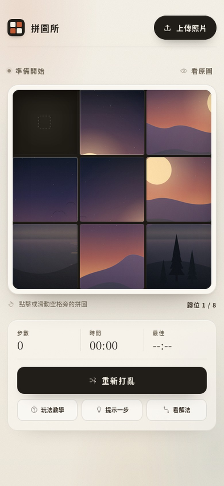
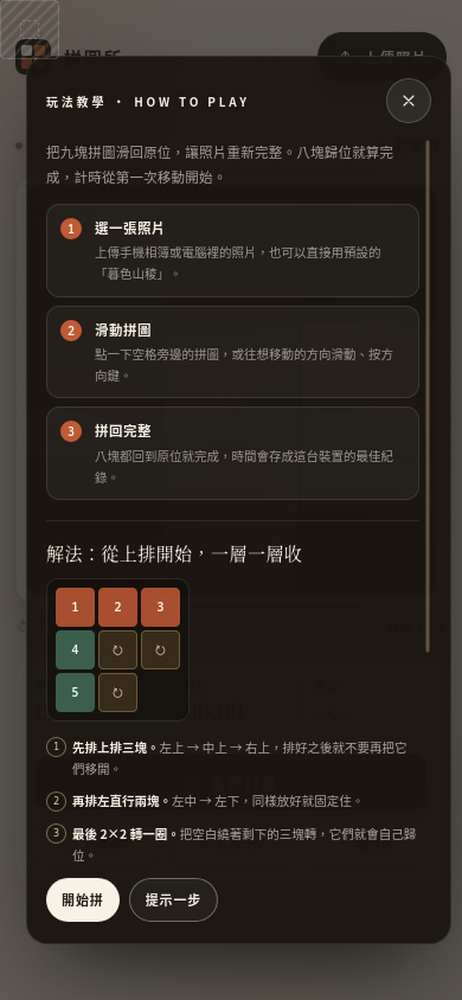

# 拼圖所 · 3×3 滑動拼圖

[](https://stansu.github.io/3x3puzzle/)


上傳一張自己的照片，切成九塊，滑動拼回完整畫面。
單一 HTML 檔、免安裝、免後端，照片只在瀏覽器裡處理，不會上傳到任何伺服器。

### ▶ 線上玩：[stansu.github.io/3x3puzzle](https://stansu.github.io/3x3puzzle/)



## 功能

**遊戲**

- 上傳手機相簿或電腦裡的照片，自動置中裁切成正方形
- 拖放圖片、貼上剪貼簿圖片
- 點擊、滑動、方向鍵三種操作方式
- 步數、計時、最佳紀錄（存在瀏覽器本機）
- 「看原圖」對照、重新打亂、完成後的紙花動畫
- 手機、平板、桌面的響應式版面

**教學與解法**

- **玩法教學**：第一次開站自動顯示，之後可隨時從「玩法教學」重看；包含三步驟、分層解法與卡關技巧
- **提示一步**：用 A* 演算法算出最短路徑，只指出下一步，並在空格顯示半透明預覽
- **看解法**：列出每一步的方向與拼圖縮圖，可「自動示範」整段解法
- 用過提示的回合不會列入最佳紀錄，計時與步數照常計算



## 玩法

1. 上傳一張照片（或直接用預設的「暮色山稜」）。
2. 點擊空格旁邊的拼圖，讓它滑進空格；也可以往想移動的方向滑動，或按方向鍵。
3. 八塊拼圖都回到原位就完成，計時從第一次移動開始。

| 操作 | 說明 |
| --- | --- |
| 滑動拼圖 | 點擊空格旁邊的拼圖，讓它滑進空格 |
| 手勢 | 在棋盤上往想移動的方向滑動 |
| 鍵盤 | 使用方向鍵滑動拼圖（`Esc` 關閉彈出面板） |
| 看原圖 | 暫時查看完整照片 |
| 重新打亂 | 保留目前照片，重新開始一局 |
| 玩法教學 | 開啟教學面板 |
| 提示一步 | 標出下一步該移動的拼圖與目的地 |
| 看解法 | 顯示最短路徑；可自動示範或自己照著走 |

## 解法：從上排開始，一層一層收

```text
① ① ①      ① 先排上排三塊：左上 → 中上 → 右上
② ③ ③      ② 再排左直行兩塊：左中 → 左下
② ③ ·      ③ 最後 2×2 把空白繞一圈
```

1. **先排上排三塊。** 排好之後就不要再把它們移開，之後的移動都只動下面兩排。
2. **再排左直行兩塊。** 左中、左下依序就位，同樣放好就固定住。
3. **最後 2×2 轉一圈。** 把空白繞著剩下的三塊轉，它們就會自己歸位。
4. **卡住的時候：** 按「提示一步」看下一步，或按「看解法」看電腦算出的最短路徑。

小技巧：一次只追一塊拼圖，先把它帶到目標位置的旁邊，再推進去；記不住畫面時按「看原圖」對照角落的顏色與線條。

## 提示與解法怎麼運作

- 求解器使用 **A\* 搜尋**，以曼哈頓距離作為估價函數，保證找到最短步數（3×3 最多 31 步，一般情況幾毫秒內完成）。
- 「提示一步」只標示下一步：來源拼圖會發光，空格會顯示半透明的目的地預覽。
- 「看解法」列出完整路徑；按「自動示範」會逐步播放，播放中再按一次即可停止。
- 只要用過提示或看過解法，完成時會標記「用了提示」，該局不寫入最佳紀錄。

## 本機執行

直接雙擊 `index.html`，用瀏覽器開啟即可遊玩，不需要安裝或啟動伺服器。

也可以起一個簡單的本機伺服器：

```bash
python3 -m http.server 8000
# 然後開啟 http://localhost:8000
```

## 部署到 GitHub Pages

目前版本已部署在 <https://stansu.github.io/3x3puzzle/>。若要放到自己的帳號：

1. 建立一個 **Public repository**，將 `index.html`（以及 `README.md`、預覽圖）放在根目錄。
2. 進入 repo 的 **Settings → Pages**。
3. **Build and deployment** 選擇：
   - Source：**Deploy from a branch**
   - Branch：`main`、Folder：`/ (root)`
4. 按下 **Save**，等待約 1～2 分鐘，網址會是 `https://<帳號>.github.io/<repo 名稱>/`。

用命令列部署：

```bash
git init
git add index.html README.md preview-mobile.jpg preview-guide.jpg
git commit -m "Add 3x3 sliding photo puzzle"
git branch -M main
git remote add origin https://github.com/<你的帳號>/<repo 名稱>.git
git push -u origin main
```

推送後再到 **Settings → Pages** 啟用 Pages。之後修改 `index.html` 並推送，通常幾十秒到幾分鐘內就會更新。

> 若 repo 名稱取為 `<帳號>.github.io`，網站會直接位於 `https://<帳號>.github.io/`。

## 專案結構

```text
.
├── index.html          # 完整拼圖程式（HTML / CSS / JS 全內嵌）
├── README.md           # 本說明
├── preview-mobile.jpg  # README 用的手機版預覽圖
└── preview-guide.jpg   # 玩法教學面板預覽圖
```

## 流量與遊玩統計

本專案使用 [GoatCounter](https://www.goatcounter.com/) 做匿名統計：**不使用 cookie、不收集個人資料，也不會接觸你選擇的照片**。

- **瀏覽量**：每次開啟頁面時自動記錄（GoatCounter 內建），可看到來源、裝置與熱門頁面。
- **遊玩事件**：以下行為會以 `event` 形式記錄，可看出大家玩到哪裡、用不用教學。

| 事件 | 觸發時機 |
| --- | --- |
| `game-start` | 每局第一次移動 |
| `game-win` | 完成拼圖 |
| `game-win-assisted` | 用過提示後完成 |
| `hint` | 按下「提示一步」 |
| `solution` | 開啟「看解法」 |
| `auto-demo` | 按下「自動示範」 |
| `upload-photo` | 成功上傳照片 |
| `guide-open` | 開啟玩法教學 |

### 啟用方式

1. 到 [goatcounter.com](https://www.goatcounter.com/) 註冊一個免費帳號。
2. **Site code** 設為 `3x3puzzle`（對應 `https://3x3puzzle.goatcounter.com`）。
3. 若使用其他 code，修改 `index.html` `<head>` 裡的 GoatCounter 網址：

```html
<script data-goatcounter="https://<你的 code>.goatcounter.com/count"
        async src="//gc.zgo.at/count.js"></script>
```

4. 之後到 [GoatCounter 後台](https://3x3puzzle.goatcounter.com) 就能看到瀏覽量與事件。

> 不想統計時，刪掉 `<head>` 裡 GoatCounter 的兩段 script 即可完全關閉。

## 隱私

- 選擇的照片只在該裝置的瀏覽器內用 Canvas 處理，不會上傳到 GitHub 或任何伺服器。
- 請不要把私人照片放進 repo；預設的「暮色山稜」是程式即時繪製的，不含私人圖片。
- 最佳時間使用 `localStorage` 保存，只存在各自的裝置與瀏覽器中。
- 流量統計使用 GoatCounter：只送出頁面路徑、事件名稱、來源與裝置資訊，不含照片、檔名或個人資料，也不使用 cookie；在 `file://`、`localhost`、`?debug`、`?nogc` 或按過 GoatCounter 退出鈕的瀏覽器上不會送出。

## 自訂

- 主色、背景色：修改 `index.html` 裡 `:root` 的 CSS 變數（例如 `--accent`）。
- 預設圖片：修改 `makeDefaultArtwork()` 函式。
- 求解器：`solvePuzzle()` 以 A\* 實作，可調整估價函數或搜尋上限。
- 統計：修改 `<head>` 裡的 `data-goatcounter` 網址；刪掉該段 script 就不再載入 GoatCounter。
- 若不想公開程式碼，可改用 Cloudflare Pages 或 Netlify 搭配私有 repo；GitHub Pages 免費方案需要公開 repo。

## 開發者小工具

- `?noguide`：略過第一次開啟時自動顯示的教學。
- `?nogc`：不送出 GoatCounter 統計（單次瀏覽用）。
- `?debug`：在瀏覽器 console 使用 `window.__puzzleDebug`（同時關閉統計）：

```js
__puzzleDebug.getState();          // 目前盤面、步數、是否完成、是否用過提示
__puzzleDebug.solve();             // 回傳目前盤面的最短步數路徑（拼圖編號）
__puzzleDebug.hint();              // 顯示下一步提示，回傳提示文字
__puzzleDebug.setBoard([0,1,2,3,4,5,6,8,7]); // 指定盤面（除錯用）
__puzzleDebug.openGuide();         // 開啟教學
__puzzleDebug.autoSolve();         // 自動示範
```

## 瀏覽器支援

支援 Chrome、Edge、Firefox、Safari 等現代瀏覽器；觸控手勢需要支援 Pointer Events 的裝置。
